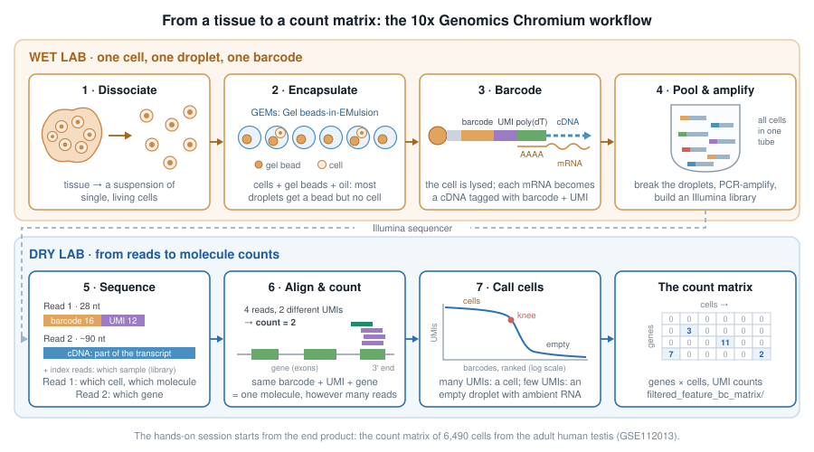
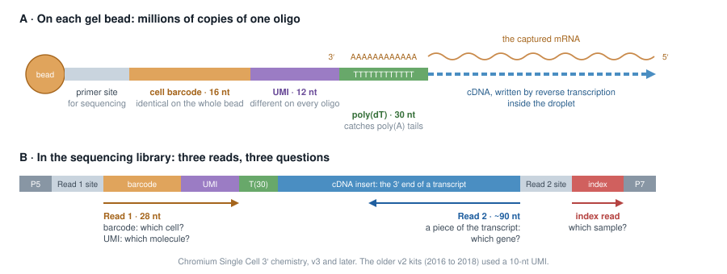
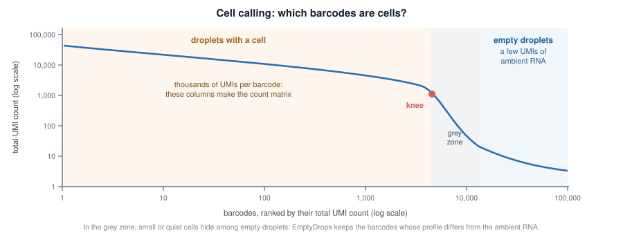
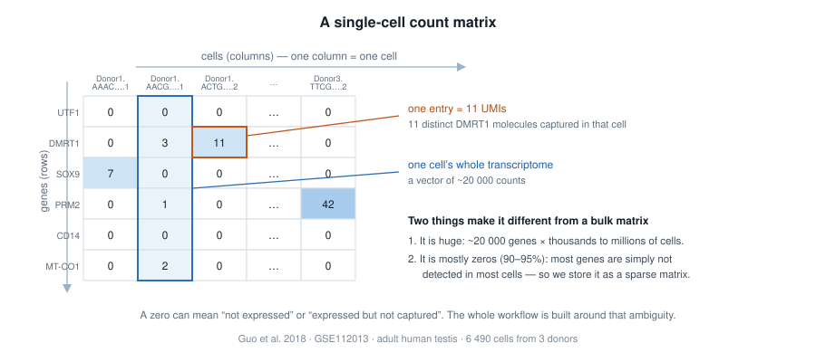
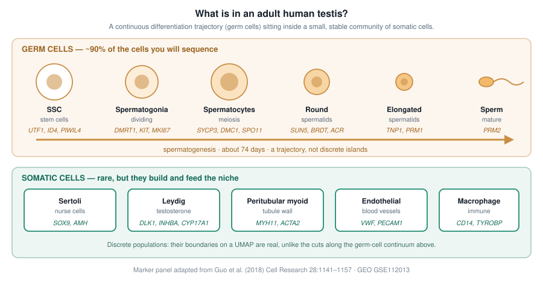

# 1  From cells to counts: the 10x Genomics workflow

> **NOTE:**
>
> It takes about 15 minutes and needs no R. The hands-on session starts where this chapter ends: with a count matrix.

Bulk RNA-seq measures the **average** transcriptome of thousands to millions of cells. That average hides what single-cell RNA-seq (scRNA-seq) is designed to reveal: which cell types a tissue contains, in which proportions, which states they go through, and which genes define each of them. A bulk profile of a testis mixes stem cells, dividing spermatogonia, meiotic spermatocytes, spermatids and a handful of somatic cell types into a single vector of numbers; the dataset of the hands-on session separates them again, cell by cell.

Many scRNA-seq technologies exist. The most widely used today isolates cells in **droplets**, and its most common implementation is the Chromium platform of 10x Genomics ([Zheng et al. 2017](#ref-zheng2017)). This chapter follows a sample through that workflow, from a piece of tissue to the object every analysis starts from: a **count matrix** of genes × cells ([Figure fig-10x](#fig-10x)).



Figure 1.1: The 10x Genomics Chromium workflow. The wet-lab steps give every molecule the barcode of its cell; the dry-lab steps read the barcodes back to count molecules per gene and per cell.

## 1.1 A suspension of single, living cells

Everything starts with **dissociation**: the tissue is digested, enzymatically and mechanically, into a suspension of single cells, which is then filtered, counted and checked for viability. That step shapes the data more than any later one:

- cells that do not survive the digestion, or are too large, too fragile or too sticky, end up under-represented or missing;
- stressed cells switch on immediate-early genes (*FOS*, *JUN*, heat-shock genes…): a well-known **dissociation signature**;
- dying cells leak their cytoplasmic mRNA through a damaged membrane. You will recognise them in the quality control of the hands-on session, by their high fraction of mitochondrial transcripts.

When a tissue cannot be dissociated (frozen archives, neurons, adipocytes…), nuclei are isolated instead, and the experiment becomes **single-nucleus** RNA-seq (snRNA-seq). The rest of the workflow is the same.

## 1.2 One cell, one droplet, one barcode

The cell suspension is loaded on a microfluidic chip together with **gel beads** and **oil**. Where the channels meet, the oil cuts the aqueous flow into tiny droplets, each carrying one gel bead: the **GEMs** (*Gel beads-in-EMulsion*).

Cells are loaded at a low concentration, so that a droplet rarely receives more than one. The price is that **most droplets contain a bead but no cell**, and that a few receive two cells or more: a **doublet**, which will look like a single cell with a hybrid profile. The doublet rate grows with the number of cells loaded: with the Chromium 3’ chemistry it is roughly 0.8% per 1,000 cells recovered, so about 8% in a 10,000-cell experiment.

### 1.2.1 What is on a gel bead?

Each bead carries millions of copies of a DNA oligonucleotide made of four parts ([Figure fig-oligo](#fig-oligo) A):

| Part | Same on… | Tells you |
|----|----|----|
| primer site | every oligo of every bead | where sequencing starts |
| **cell barcode** (16 nt) | all the oligos of one bead | which droplet, hence which **cell** |
| **UMI** (*Unique Molecular Identifier*, 12 nt) | nothing: random on each oligo | which **molecule** |
| poly(dT) (30 nt) | every oligo | nothing: it catches the poly(A) tail of mRNAs |

The beads are made from millions of possible barcodes, so two beads of the same experiment almost never share one.



Figure 1.2: The oligonucleotide of a 10x gel bead (A), and the structure of the library that is eventually sequenced (B).

### 1.2.2 Inside the droplet

In each GEM, the gel bead dissolves and releases its oligos, the cell is lysed, and its polyadenylated mRNAs hybridise to the poly(dT). A reverse transcriptase copies each captured mRNA into a cDNA that starts with the oligo: **every cDNA now carries the barcode of its droplet and a UMI of its own**. The enzyme also adds a few bases at the end of the cDNA, onto which a *template-switch oligo* binds, so that all cDNAs end up with known sequences at both ends and can be amplified together with a single pair of primers.

This is the whole trick of droplet scRNA-seq: from then on, molecules from all cells can be mixed in one tube, because each one carries the address of its cell.

The capture is far from complete: only a fraction of the mRNA molecules of each cell is caught and copied. This is where the many zeros of the count matrix come from.

## 1.3 Pool, amplify, build a library

The emulsion is then broken, and the barcoded cDNAs of all cells are pooled. They are amplified by PCR, fragmented, and fitted with Illumina adapters and a **sample index**, which lets several libraries share a sequencing run. Only the fragments that contain the 3’ end of a transcript keep the barcode and the UMI ([Figure fig-oligo](#fig-oligo) B): the library tells you **which transcripts** a cell contained, and how many, not their full-length sequence. Other kits read the 5’ end instead, mostly to profile immune receptors.

PCR copies some molecules more than others. This is exactly what UMIs are for: all the copies of one original molecule share the same barcode, the same UMI and the same gene, so they can be collapsed back into a single count.

## 1.4 Three reads, three questions

The library is sequenced on an Illumina instrument, and each fragment gives ([Figure fig-oligo](#fig-oligo) B):

- **Read 1** (28 nt): the barcode and the UMI. *Which cell? Which molecule?*
- **Read 2** (typically 90 nt): a piece of the transcript. *Which gene?*
- the **index read(s)**: the sample index. *Which sample?*

A common target is 20,000 to 50,000 read pairs per cell.

## 1.5 From reads to counts

10x Genomics’ software, **Cell Ranger** (`cellranger count`), turns the sequencing reads (FASTQ files) into a count matrix in four steps:

1.  **Barcodes.** Each barcode read is checked against the list of barcodes present on the beads, and corrected when a single base is off.
2.  **Alignment.** Read 2 is aligned to the reference genome and assigned to a gene when it falls in its exons or, by default since Cell Ranger 7, its introns.
3.  **UMI counting.** Reads with the same barcode, the same UMI and the same gene are copies of one molecule: they count once. A number in the matrix is a number of **molecules**, not of reads.
4.  **Cell calling.** Barcodes are ranked by their total number of UMIs ([Figure fig-knee](#fig-knee)). Droplets with a cell have many; empty droplets, much more numerous, have a few, coming from the *ambient RNA* that floats in the suspension (often released by damaged cells). Cell Ranger keeps the barcodes above the “knee” of that curve, then rescues lower-count barcodes whose profile differs from the ambient one, an approach called EmptyDrops ([Lun et al. 2019](#ref-lun2019)).



Figure 1.3: A barcode-rank plot, the curve every 10x experiment is first judged on.

Other tools do the same job, often faster: STARsolo, alevin-fry, kallisto \| bustools.

Among other things, Cell Ranger writes:

- `web_summary.html`, a quality report (number of cells, reads per cell, median genes per cell…): always the first file to open;
- `raw_feature_bc_matrix/`, the counts of **all** barcodes, empty droplets included;
- `filtered_feature_bc_matrix/`, the counts of the barcodes called as cells.

Each matrix is stored in a sparse format of three files:

    filtered_feature_bc_matrix/
    ├── barcodes.tsv.gz   # one line per cell (columns)
    ├── features.tsv.gz   # one line per gene (rows): Ensembl ID, symbol
    └── matrix.mtx.gz     # only the non-zero entries: row, column, count

which the `DropletUtils` package reads straight into a `SingleCellExperiment`, the object of the hands-on session:

``` r
library(DropletUtils)
sce <- read10xCounts("path/to/filtered_feature_bc_matrix")
```

## 1.6 The count matrix



Figure 1.4: Anatomy of a single-cell count matrix.

Three ideas to carry into the hands-on session:

- **A column is one cell.** Its ~20,000 numbers are that cell’s transcriptome, as far as it was captured.
- **An entry is a UMI count**: the number of distinct molecules of that gene captured in that cell. Not reads: molecules. That is why the numbers are small.
- **Most entries are zero**, and a zero is ambiguous: the gene may be off, or on but missed by a capture that only catches a fraction of the mRNAs of a cell. Almost every step of the analysis is designed around that ambiguity.

Cell calling does not make every column a good cell either: some barcodes are empty droplets that passed the threshold, some are damaged or dying cells, some are doublets. Finding them is the first job of the hands-on session.

> **TIP:**
>
> Sequencing-based spatial methods, such as 10x Visium, reuse the barcode + UMI logic. Instead of a bead per droplet, a glass slide carries spots of oligos with a **spatial barcode**: the barcode no longer tells which cell a molecule came from, but **where** in the tissue section it was captured. The result is again a count matrix, of genes × spots.

## 1.7 The dataset of the hands-on session

We will analyse the adult human testis atlas of Guo et al. ([2018](#ref-guo2018)): testicular tissue from three healthy young donors, each dissociated and captured on the 10x Chromium platform in two technical replicates. The authors processed the reads with Cell Ranger and deposited a single table of UMI counts for 6,490 cells on GEO ([GSE112013](https://www.ncbi.nlm.nih.gov/geo/query/acc.cgi?acc=GSE112013)): that table is where we start.

The testis is a good teaching tissue because it holds two very different kinds of biology at once ([Figure fig-testis](#fig-testis)): a **continuous differentiation trajectory**, the germ cells going through spermatogenesis, and a few **discrete populations** of somatic cells. Both will show up on the same map of the cells.



Figure 1.5: Cell types of the adult human testis, and the marker genes we will use to recognise them.

## Going further

- Zheng et al. ([2017](#ref-zheng2017)) describe the droplet technology behind the 10x Chromium platform.
- The [Cell Ranger documentation](https://www.10xgenomics.com/support/software/cell-ranger) details each step of the processing, and how to read its `web_summary.html`.
- Luecken and Theis ([2019](#ref-luecken2019)) and Heumos et al. ([2023](#ref-heumos2023)) review the analysis steps of the hands-on session, and their alternatives.

Guo, Jingtao, Edward J. Grow, Hana Mlcochova, Geoffrey J. Maher, Cecilia Lindskog, et al. 2018. “The Adult Human Testis Transcriptional Cell Atlas.” *Cell Research* 28: 1141–57. <https://doi.org/10.1038/s41422-018-0099-2>.

Heumos, Lukas, Anna C. Schaar, Christopher Lance, et al. 2023. “Best Practices for Single-Cell Analysis Across Modalities.” *Nature Reviews Genetics* 24: 550–72. <https://doi.org/10.1038/s41576-023-00586-w>.

Luecken, Malte D., and Fabian J. Theis. 2019. “Current Best Practices in Single-Cell RNA-seq Analysis: A Tutorial.” *Molecular Systems Biology* 15: e8746. <https://doi.org/10.15252/msb.20188746>.

Lun, Aaron T. L., Samantha Riesenfeld, Tallulah Andrews, et al. 2019. “EmptyDrops: Distinguishing Cells from Empty Droplets in Droplet-Based Single-Cell RNA Sequencing Data.” *Genome Biology* 20: 63. <https://doi.org/10.1186/s13059-019-1662-y>.

Zheng, Grace X. Y., Jessica M. Terry, Phillip Belgrader, et al. 2017. “Massively Parallel Digital Transcriptional Profiling of Single Cells.” *Nature Communications* 8: 14049. <https://doi.org/10.1038/ncomms14049>.
