# 2  Hands-on: from a count matrix to cell types

In 2h30, we go from the count matrix described in [sec-10x](#sec-10x) to a map of the adult human testis with a name on every population, and to a first differential expression analysis. Every step adds something to **one object**, a `SingleCellExperiment`, which grows as we go ([Figure fig-workflow](#fig-workflow)).

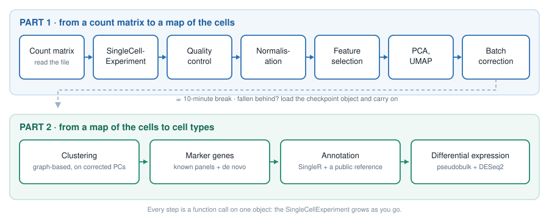

Figure 2.1: The standard Bioconductor single-cell workflow, in two parts separated by a break.

| Time | Section                                               | Duration |
|------|-------------------------------------------------------|----------|
| 0:00 | [Setup](#sec-setup)                                   | 5 min    |
| 0:05 | [Reading the count matrix](#sec-read)                 | 10 min   |
| 0:15 | [The `SingleCellExperiment`](#sec-sce)                | 15 min   |
| 0:30 | [Quality control](#sec-qc)                            | 15 min   |
| 0:45 | [Normalisation](#sec-norm)                            | 10 min   |
| 0:55 | [Feature selection](#sec-hvg)                         | 5 min    |
| 1:00 | [Dimensionality reduction](#sec-dimred)               | 10 min   |
| 1:10 | [Batch effects](#sec-batch)                           | 10 min   |
| 1:20 | ☕ [Break, and checkpoint](#sec-checkpoint)           | 10 min   |
| 1:30 | [Clustering](#sec-clustering)                         | 15 min   |
| 1:45 | [Marker genes](#sec-markers)                          | 15 min   |
| 2:00 | [Annotation with a reference](#sec-annotation)        | 10 min   |
| 2:10 | [Pseudobulk differential expression](#sec-pseudobulk) | 15 min   |
| 2:25 | [Wrap-up](#sec-wrap-up)                               | 5 min    |

> **TIP:**
>
> - **Type the code, do not paste it.** You will remember a function because your fingers typed it. Typos are part of the lesson: you will see the error message, and learn what it means.
> - **Say when you are stuck, straight away.** A helper will come while the session goes on.
> - **If you fall behind, stop typing and watch.** It is better to see the next step than to be stuck on the previous one: at the break, a checkpoint object gets everyone back on track ([sec-checkpoint](#sec-checkpoint)).

## 2.1 Setup

In RStudio, open a new R script (*File* \> *New File* \> *R Script*) and save it, as `workshop.R` for instance. Type the code of the session in it, and run each line with .

We load the packages as we need them. Here they are, and what they are for:

| Package | Used for |
|----|----|
| `BiocFileCache` | downloading the data once, and re-using it afterwards |
| `Matrix` | sparse matrices |
| `SingleCellExperiment` | the container for single-cell data |
| `scrapper` | QC, normalisation, feature selection, PCA, UMAP, batch correction, clustering, marker genes, pseudobulk |
| `scater`, `ggplot2`, `patchwork` | plots |
| `SingleR` | annotation against a reference |
| `DESeq2` | differential expression |

They are all installed in the workshop environment. To check that they are installed on your own computer, type [`library(scrapper)`](https://github.com/libscran/scrapper): an error means that the package is missing.

## 2.2 Reading the count matrix

### 2.2.1 Downloading the data, once

The count matrix of Guo et al. ([2018](#ref-guo2018)) is a gzipped text file on GEO. `BiocFileCache` downloads a file the first time you ask for it, and simply returns the path to its local copy afterwards. In the workshop environment, the file is already in the cache: asking for it costs nothing. (The URL is the only line of the day worth copy-pasting.)

``` r
library(BiocFileCache)
bfc <- BiocFileCache(ask = FALSE)
umi_url <- "https://ftp.ncbi.nlm.nih.gov/geo/series/GSE112nnn/GSE112013/suppl/GSE112013_Combined_UMI_table.txt.gz"
umi_path <- bfcrpath(bfc, umi_url)
umi_path
##                                                                           BFC1 
##  "/opt/R-cache/R/BiocFileCache/fb663f9dea_GSE112013_Combined_UMI_table.txt.gz"
```

### 2.2.2 Reading it into R

The file is a table with one row per gene and one column per cell. It is big: reading it takes about a minute.

``` r
umi <- read.delim(umi_path, header = TRUE, row.names = 1)
dim(umi)
##  [1] 27477  6490
umi[1:5, 1:3]
##               Donor2.AAACCTGGTGCCTTGG.1 Donor2.AAACCTGTCAACGGGA.1
##  RP11-34P13.3                         0                         0
##  RP11-34P13.7                         0                         0
##  FO538757.3                           0                         0
##  FO538757.2                           0                         1
##  AP006222.2                           0                         0
##               Donor2.AAACCTGTCCTATGTT.1
##  RP11-34P13.3                         0
##  RP11-34P13.7                         0
##  FO538757.3                           0
##  FO538757.2                           0
##  AP006222.2                           0
```

A `data.frame` is not the right container for numbers that all have the same type: turn it into a matrix.

``` r
counts_dense <- as.matrix(umi)
class(counts_dense)
##  [1] "matrix" "array"
format(object.size(counts_dense), units = "MB")
##  [1] "682.6 Mb"
```

### 2.2.3 Making it sparse

This matrix stores every single zero. A **sparse** matrix only stores the non-zero entries, and their positions:

``` r
library(Matrix)
counts_sparse <- Matrix(counts_dense, sparse = TRUE)
class(counts_sparse)
##  [1] "dgCMatrix"
##  attr(,"package")
##  [1] "Matrix"
format(object.size(counts_sparse), units = "MB")
##  [1] "231.2 Mb"
```

What fraction of the entries is not zero?

``` r
nnzero(counts_sparse) / length(counts_sparse)
##  [1] 0.112161
```

Only about 1 entry in 10. We no longer need the dense copies: remove them, and let R give the memory back.

``` r
rm(umi, counts_dense)
invisible(gc())
```

> **NOTE:**
>
> Cell Ranger’s `filtered_feature_bc_matrix/` folder ([sec-cellranger](#sec-cellranger)) is already sparse: `DropletUtils::read10xCounts()` reads it straight into a `SingleCellExperiment`, the object we build next.

## 2.3 The `SingleCellExperiment`


Figure 2.2: Anatomy of a `SingleCellExperiment`.

A matrix of counts is not enough: we will need to keep information about every cell (donor, quality metrics, cluster…) and every gene (is it variable?), plus several transformed versions of the matrix and low-dimensional embeddings, without ever mixing up their rows and columns.

Bioconductor’s answer is the `SummarizedExperiment`, the container used for bulk RNA-seq: one or more matrices (the *assays*) of genes × samples, a table describing the rows ([`rowData()`](https://rdrr.io/pkg/SummarizedExperiment/man/SummarizedExperiment-class.html)), and a table describing the columns ([`colData()`](https://rdrr.io/pkg/SummarizedExperiment/man/SummarizedExperiment-class.html)), locked together. A **`SingleCellExperiment` is a `SummarizedExperiment` whose columns are cells**, with a few extra slots for single-cell analysis, such as [`reducedDims()`](https://rdrr.io/pkg/SingleCellExperiment/man/reducedDims.html) for embeddings ([Figure fig-sce](#fig-sce)).

``` r
library(SingleCellExperiment)
sce <- SingleCellExperiment(assays = list(counts = counts_sparse))
sce
##  class: SingleCellExperiment 
##  dim: 27477 6490 
##  metadata(0):
##  assays(1): counts
##  rownames(27477): RP11-34P13.3 RP11-34P13.7 ... AC136612.1 AC145212.4
##  rowData names(0):
##  colnames(6490): Donor2.AAACCTGGTGCCTTGG.1 Donor2.AAACCTGTCAACGGGA.1
##    ... Donor1.TTTGTCAGTGTGCGTC.2 Donor1.TTTGTCATCCAAACTG.2
##  colData names(0):
##  reducedDimNames(0):
##  mainExpName: NULL
##  altExpNames(0):
```

Read that printout: it is the map of the object. Each slot has its accessor:

``` r
dim(sce)
##  [1] 27477  6490
assayNames(sce)
##  [1] "counts"
counts(sce)[1:5, 1:3]
##  5 x 3 sparse Matrix of class "dgCMatrix"
##               Donor2.AAACCTGGTGCCTTGG.1 Donor2.AAACCTGTCAACGGGA.1
##  RP11-34P13.3                         .                         .
##  RP11-34P13.7                         .                         .
##  FO538757.3                           .                         .
##  FO538757.2                           .                         1
##  AP006222.2                           .                         .
##               Donor2.AAACCTGTCCTATGTT.1
##  RP11-34P13.3                         .
##  RP11-34P13.7                         .
##  FO538757.3                           .
##  FO538757.2                           .
##  AP006222.2                           .
head(rownames(sce))
##  [1] "RP11-34P13.3"  "RP11-34P13.7"  "FO538757.3"    "FO538757.2"   
##  [5] "AP006222.2"    "RP4-669L17.10"
head(colnames(sce), 3)
##  [1] "Donor2.AAACCTGGTGCCTTGG.1" "Donor2.AAACCTGTCAACGGGA.1"
##  [3] "Donor2.AAACCTGTCCTATGTT.1"
```

### 2.3.1 Cell metadata is hiding in the column names

`colData(sce)` is empty for now. We have no sample sheet, but the name of each cell tells us where it comes from: `Donor2.AAACCTGGTGCCTTGG.1` is the cell with the 16-nt barcode `AAACCTGGTGCCTTGG` ([sec-gems](#sec-gems)), from replicate `1` of `Donor2`. Split the names on the dots, and keep each piece:

``` r
split_names <- strsplit(colnames(sce), "\\.")
split_names[1:2]
##  [[1]]
##  [1] "Donor2"           "AAACCTGGTGCCTTGG" "1"               
##  
##  [[2]]
##  [1] "Donor2"           "AAACCTGTCAACGGGA" "1"
```

`$` adds a column to [`colData()`](https://rdrr.io/pkg/SummarizedExperiment/man/SummarizedExperiment-class.html), exactly as it adds a column to a data frame:

``` r
sce$Donor <- sapply(split_names, function(x) x[1])
sce$Barcode <- sapply(split_names, function(x) x[2])
sce$Replicate <- sapply(split_names, function(x) x[3])
sce$Sample <- paste(sce$Donor, sce$Replicate, sep = "_rep")
colData(sce)
##  DataFrame with 6490 rows and 4 columns
##                                  Donor          Barcode   Replicate
##                            <character>      <character> <character>
##  Donor2.AAACCTGGTGCCTTGG.1      Donor2 AAACCTGGTGCCTTGG           1
##  Donor2.AAACCTGTCAACGGGA.1      Donor2 AAACCTGTCAACGGGA           1
##  Donor2.AAACCTGTCCTATGTT.1      Donor2 AAACCTGTCCTATGTT           1
##  Donor2.AAACCTGTCGGACAAG.1      Donor2 AAACCTGTCGGACAAG           1
##  Donor2.AAACGGGAGCTATGCT.1      Donor2 AAACGGGAGCTATGCT           1
##  ...                               ...              ...         ...
##  Donor1.TTTGTCAAGAACTCGG.2      Donor1 TTTGTCAAGAACTCGG           2
##  Donor1.TTTGTCAAGGATGGTC.2      Donor1 TTTGTCAAGGATGGTC           2
##  Donor1.TTTGTCAGTAAGGGAA.2      Donor1 TTTGTCAGTAAGGGAA           2
##  Donor1.TTTGTCAGTGTGCGTC.2      Donor1 TTTGTCAGTGTGCGTC           2
##  Donor1.TTTGTCATCCAAACTG.2      Donor1 TTTGTCATCCAAACTG           2
##                                 Sample
##                            <character>
##  Donor2.AAACCTGGTGCCTTGG.1 Donor2_rep1
##  Donor2.AAACCTGTCAACGGGA.1 Donor2_rep1
##  Donor2.AAACCTGTCCTATGTT.1 Donor2_rep1
##  Donor2.AAACCTGTCGGACAAG.1 Donor2_rep1
##  Donor2.AAACGGGAGCTATGCT.1 Donor2_rep1
##  ...                               ...
##  Donor1.TTTGTCAAGAACTCGG.2 Donor1_rep2
##  Donor1.TTTGTCAAGGATGGTC.2 Donor1_rep2
##  Donor1.TTTGTCAGTAAGGGAA.2 Donor1_rep2
##  Donor1.TTTGTCAGTGTGCGTC.2 Donor1_rep2
##  Donor1.TTTGTCATCCAAACTG.2 Donor1_rep2
table(sce$Donor, sce$Replicate)
##          
##              1    2
##    Donor1 1000 1248
##    Donor2  985 1009
##    Donor3 1116 1132
```

Three donors, two 10x runs each: **six libraries**, for **three biological replicates**. Keep that in mind: it makes all the difference in [sec-pseudobulk](#sec-pseudobulk).

## 2.4 Quality control

Not every column of the matrix is a healthy cell ([sec-count-matrix](#sec-count-matrix)). Some barcodes are droplets that only caught ambient RNA, some are cells that were damaged or dying, some are two cells captured together. We remove the worst of them **first**, as they would distort every later step.

Three metrics are computed for each cell:

| Metric | Low-quality cells have | Because |
|----|----|----|
| total UMI count (`sum`) | few | little RNA was captured |
| number of detected genes (`detected`) | few | same reason |
| proportion of counts from mitochondrial genes | many | a damaged cell loses its cytoplasmic mRNA, while the transcripts inside the mitochondria stay behind |

### 2.4.1 Computing the metrics

Mitochondrial genes are recognisable by their symbol, which starts with `MT-`:

``` r
is_mito <- grepl("^MT-", rownames(sce))
sum(is_mito)
##  [1] 13
rownames(sce)[is_mito]
##   [1] "MT-ND1"  "MT-ND2"  "MT-CO1"  "MT-CO2"  "MT-ATP8" "MT-ATP6" "MT-CO3" 
##   [8] "MT-ND3"  "MT-ND4L" "MT-ND4"  "MT-ND5"  "MT-ND6"  "MT-CYB"
```

[`quickRnaQc.se()`](https://rdrr.io/pkg/scrapper/man/quickRnaQc.se.html) computes the three metrics, stores them in [`colData()`](https://rdrr.io/pkg/SummarizedExperiment/man/SummarizedExperiment-class.html), and flags outlier cells: a cell is an outlier when one of its metrics sits more than 3 *median absolute deviations* (MADs) away from the median, on the bad side (too few counts or genes, too many mitochondrial counts). Our six libraries were sequenced to different depths, so the thresholds are computed within each library, with `block =`.

``` r
library(scrapper)
sce <- quickRnaQc.se(
    sce,
    subsets = list(Mito = is_mito),
    block = sce$Sample
)
colData(sce)
##  DataFrame with 6490 rows and 8 columns
##                                  Donor          Barcode   Replicate
##                            <character>      <character> <character>
##  Donor2.AAACCTGGTGCCTTGG.1      Donor2 AAACCTGGTGCCTTGG           1
##  Donor2.AAACCTGTCAACGGGA.1      Donor2 AAACCTGTCAACGGGA           1
##  Donor2.AAACCTGTCCTATGTT.1      Donor2 AAACCTGTCCTATGTT           1
##  Donor2.AAACCTGTCGGACAAG.1      Donor2 AAACCTGTCGGACAAG           1
##  Donor2.AAACGGGAGCTATGCT.1      Donor2 AAACGGGAGCTATGCT           1
##  ...                               ...              ...         ...
##  Donor1.TTTGTCAAGAACTCGG.2      Donor1 TTTGTCAAGAACTCGG           2
##  Donor1.TTTGTCAAGGATGGTC.2      Donor1 TTTGTCAAGGATGGTC           2
##  Donor1.TTTGTCAGTAAGGGAA.2      Donor1 TTTGTCAGTAAGGGAA           2
##  Donor1.TTTGTCAGTGTGCGTC.2      Donor1 TTTGTCAGTGTGCGTC           2
##  Donor1.TTTGTCATCCAAACTG.2      Donor1 TTTGTCATCCAAACTG           2
##                                 Sample       sum  detected
##                            <character> <numeric> <integer>
##  Donor2.AAACCTGGTGCCTTGG.1 Donor2_rep1     11454      4323
##  Donor2.AAACCTGTCAACGGGA.1 Donor2_rep1     10149      1613
##  Donor2.AAACCTGTCCTATGTT.1 Donor2_rep1     11672      2212
##  Donor2.AAACCTGTCGGACAAG.1 Donor2_rep1      9140      1884
##  Donor2.AAACGGGAGCTATGCT.1 Donor2_rep1      7849      1991
##  ...                               ...       ...       ...
##  Donor1.TTTGTCAAGAACTCGG.2 Donor1_rep2      5648      2730
##  Donor1.TTTGTCAAGGATGGTC.2 Donor1_rep2      5942      3098
##  Donor1.TTTGTCAGTAAGGGAA.2 Donor1_rep2     59903      7522
##  Donor1.TTTGTCAGTGTGCGTC.2 Donor1_rep2      6499      1720
##  Donor1.TTTGTCATCCAAACTG.2 Donor1_rep2      5910      3109
##                            subset.proportion.Mito      keep
##                                         <numeric> <logical>
##  Donor2.AAACCTGGTGCCTTGG.1             0.00934171      TRUE
##  Donor2.AAACCTGTCAACGGGA.1             0.00413834      TRUE
##  Donor2.AAACCTGTCCTATGTT.1             0.01070939      TRUE
##  Donor2.AAACCTGTCGGACAAG.1             0.01039387      TRUE
##  Donor2.AAACGGGAGCTATGCT.1             0.00394955      TRUE
##  ...                                          ...       ...
##  Donor1.TTTGTCAAGAACTCGG.2             0.16643059      TRUE
##  Donor1.TTTGTCAAGGATGGTC.2             0.01565130      TRUE
##  Donor1.TTTGTCAGTAAGGGAA.2             0.04675893      TRUE
##  Donor1.TTTGTCAGTGTGCGTC.2             0.04754578      TRUE
##  Donor1.TTTGTCATCCAAACTG.2             0.00896785      TRUE
```

The thresholds used for each library are stored in [`metadata()`](https://rdrr.io/pkg/S4Vectors/man/Annotated-class.html):

``` r
metadata(sce)$qc$thresholds
##  $sum
##  Donor1_rep1 Donor1_rep2 Donor2_rep1 Donor2_rep2 Donor3_rep1 Donor3_rep2 
##     1140.182    1207.056    1599.060    1646.766    1316.144    1341.656 
##  
##  $detected
##  Donor1_rep1 Donor1_rep2 Donor2_rep1 Donor2_rep2 Donor3_rep1 Donor3_rep2 
##     445.5884    468.5816    537.0300    552.4423    371.2207    345.5814 
##  
##  $subset.proportion
##  $subset.proportion$Mito
##  Donor1_rep1 Donor1_rep2 Donor2_rep1 Donor2_rep2 Donor3_rep1 Donor3_rep2 
##   0.22611235  0.25926253  0.09194084  0.04484880  0.07568231  0.11273757 
##  
##  
##  $block.ids
##  [1] "Donor1_rep1" "Donor1_rep2" "Donor2_rep1" "Donor2_rep2" "Donor3_rep1"
##  [6] "Donor3_rep2"
```

and `keep` says which cells pass:

``` r
table(sce$Sample, sce$keep)
##               
##                FALSE TRUE
##    Donor1_rep1     0 1000
##    Donor1_rep2     0 1248
##    Donor2_rep1   136  849
##    Donor2_rep2   343  666
##    Donor3_rep1   259  857
##    Donor3_rep2   169  963
```

### 2.4.2 Look before you filter

Always plot what you are about to throw away:

``` r
library(scater)
library(ggplot2)
library(patchwork)
p_sum <- plotColData(sce, x = "Sample", y = "sum", colour_by = "keep") +
    scale_y_log10()
p_mito <- plotColData(
    sce, x = "Sample", y = "subset.proportion.Mito", colour_by = "keep"
)
p_sum / p_mito
```

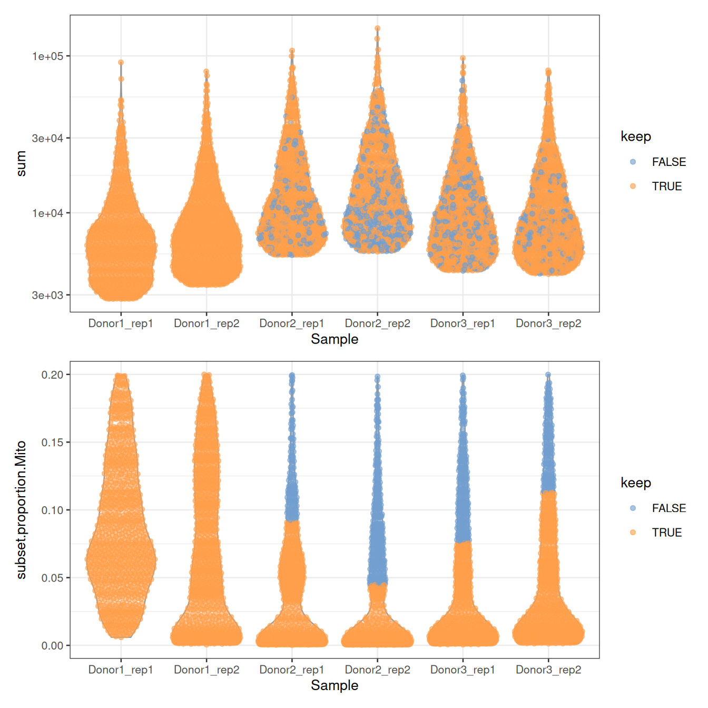

`/` stacks two plots with `patchwork`. Notice the ceilings: no cell has more than 20% of mitochondrial counts, nor fewer than about 2,800 UMIs. The authors filtered the table before depositing it, which is common: always check what was done to the data you download.

> **NOTE:**
>
> Not a single cell of `Donor1` is discarded. Why? Is it good news?

> **NOTE:**
>
> Look at the thresholds on the mitochondrial proportion, in %:
>
> ``` r
> round(100 * metadata(sce)$qc$thresholds$subset.proportion$Mito)
> ##  Donor1_rep1 Donor1_rep2 Donor2_rep1 Donor2_rep2 Donor3_rep1 Donor3_rep2 
> ##           23          26           9           4           8          11
> ```
>
> The cells of `Donor1` have more mitochondrial counts overall: the median and the MAD of its libraries are higher, and so is their threshold, above the 20% ceiling of the table. None of its cells is far enough from its own median to be flagged.
>
> Thresholds computed within each library are **relative**: they assume that most cells of each library are fine, and adapt to each of them. A cell with 15% of mitochondrial counts is thus discarded from `Donor2` and `Donor3`, but kept in `Donor1`. A fixed threshold, say `sce$subset.proportion.Mito < 0.1`, would treat all libraries the same. Neither choice is right in general: make it knowingly, and look at the plots.

We’ll skip filtering for now and retain all cells.

We keep 5,583 cells.

> **NOTE:**
>
> Two more filters are often applied, which we skip today for lack of time: **doublets** can be found with `scDblFinder` ([Germain et al. 2021](#ref-germain2021)), and the contamination by **ambient RNA** can be estimated and removed with `decontX` or `SoupX`.

## 2.5 Normalisation

Two cells can have different total counts for biological reasons (one is bigger, or more active) or technical ones (one was captured, reverse-transcribed or sequenced more efficiently). Normalisation removes the technical part, so that expression values can be compared between cells.

The simplest approach divides the counts of each cell by a **size factor** proportional to its library size, its total UMI count. The normalised values are then log-transformed: a pseudo-count of 1 avoids taking the log of zero, and the log turns fold changes into differences, so that a few very highly expressed genes do not dominate everything else.

``` r
sce <- normalizeRnaCounts.se(
    sce,
    size.factors = sce$sum,
    block = sce$Sample
)
summary(sce$sizeFactor)
##     Min. 1st Qu.  Median    Mean 3rd Qu.    Max. 
##   0.3386  0.6902  1.0086  1.4948  1.7487 17.9720
assayNames(sce)
##  [1] "counts"    "logcounts"
```

With `block = sce$Sample`, the size factors also account for the six libraries having been sequenced to different depths. `logcounts` holds \\\log_2(\text{count} / \text{size factor} + 1)\\:

``` r
logcounts(sce)[c("PRM1", "SOX9", "ACTA2"), 1:3]
##  <3 x 3> sparse DelayedMatrix object of type "double":
##        Donor2.AAACCTGGTGCCTTGG.1 Donor2.AAACCTGTCAACGGGA.1
##  PRM1                   7.211376                 11.360510
##  SOX9                   0.000000                  0.000000
##  ACTA2                  0.000000                  0.000000
##        Donor2.AAACCTGTCCTATGTT.1
##  PRM1                  11.101815
##  SOX9                   0.000000
##  ACTA2                  0.000000
```

From now on, everything about **expression** uses `logcounts`; everything about **counts**, such as differential expression ([sec-pseudobulk](#sec-pseudobulk)), goes back to `counts`.

> **NOTE:**
>
> When cell types express very different sets of genes, library size factors are slightly biased: this is *composition bias*. It rarely changes the clusters, but `scran`’s deconvolution method corrects it ([Lun et al. 2016](#ref-lun2016)): compute the size factors with `scuttle::pooledSizeFactors(sce, clusters = scran::quickCluster(sce))`, and pass them to `normalizeRnaCounts.se(size.factors = ...)`.

## 2.6 Feature selection

Of the 27,477 genes, most are not expressed at all, or expressed at similar levels in every cell. They carry no information about which cell is which, but add noise to every comparison between cells. We keep the **highly variable genes** (HVGs): those whose variance across cells is much larger than expected for a gene of the same average expression.

``` r
sce <- chooseRnaHvgs.se(sce, block = sce$Sample, top = 2000)
rowData(sce)
##  DataFrame with 27477 rows and 5 columns
##                     means   variances      fitted    residuals       hvg
##                 <numeric>   <numeric>   <numeric>    <numeric> <logical>
##  RP11-34P13.3  0.00151787  0.00120802  0.00159690 -0.000388886     FALSE
##  RP11-34P13.7  0.00841877  0.00679390  0.00947646 -0.002682559     FALSE
##  FO538757.3    0.00189164  0.00167327  0.00213801 -0.000464741     FALSE
##  FO538757.2    0.28648468  0.25988065  0.26368683 -0.003806179     FALSE
##  AP006222.2    0.21583228  0.20760767  0.19892968  0.008677993     FALSE
##  ...                  ...         ...         ...          ...       ...
##  CMP21-97G8.2 0.000257234 0.000221711 0.000322184 -1.00473e-04     FALSE
##  AF064858.7   0.000263561 0.000208246 0.000346215 -1.37970e-04     FALSE
##  LINC00165    0.000361595 0.000253216 0.000452895 -1.99680e-04     FALSE
##  AC136612.1   0.001369787 0.001432333 0.001817273 -3.84940e-04     FALSE
##  AC145212.4   0.000541101 0.000728393 0.000688319  4.00744e-05     FALSE
sum(rowData(sce)$hvg)
##  [1] 2000
```

[`rowData()`](https://rdrr.io/pkg/SummarizedExperiment/man/SummarizedExperiment-class.html) now holds, for each gene, its mean and variance of expression, the variance expected from the trend fitted to all genes (`fitted`), the excess over that trend (`residuals`), and whether it is one of the 2,000 HVGs:

``` r
gene_stats <- as.data.frame(rowData(sce))
ggplot(gene_stats, aes(x = means, y = variances, colour = hvg)) +
    geom_point(size = 0.5) +
    geom_line(aes(y = fitted), colour = "dodgerblue", linewidth = 1) +
    scale_colour_manual(values = c(`FALSE` = "grey70", `TRUE` = "firebrick")) +
    labs(x = "Mean of log-expression", y = "Variance of log-expression") +
    theme_bw()
```

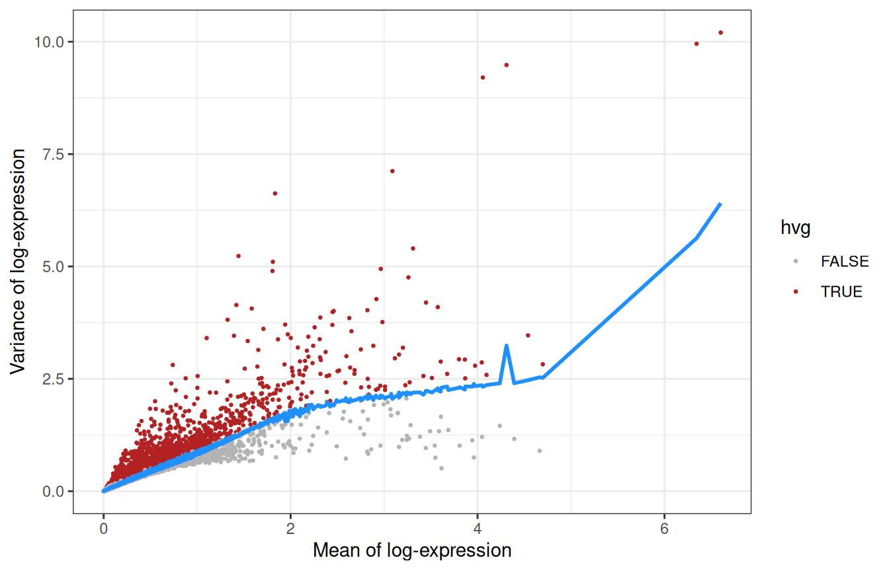

The genes furthest above the trend:

``` r
top_hvgs <- rownames(gene_stats)[order(gene_stats$residuals, decreasing = TRUE)]
head(top_hvgs, 20)
##   [1] "MALAT1"     "TNP1"       "AC007557.1" "PTGDS"      "PRM2"      
##   [6] "IGFBP7"     "PRM1"       "TMSB4X"     "RPL10"      "HMGB4"     
##  [11] "B2M"        "LELP1"      "RPL39"      "VIM"        "CRISP2"    
##  [16] "S100A6"     "RPS4X"      "NUPR2"      "RPL21"      "DCN"
```

**Recognise anything?** `TNP1`, `PRM1` and `PRM2` (transition protein and protamines), `HMGB4` and `LELP1` are expressed late in spermatogenesis, while `PTGDS`, `IGFBP7` or `DCN` come from somatic cells: feature selection has found the main axes of variation of a testis without being told anything about testes.

## 2.7 Dimensionality reduction

### 2.7.1 PCA

2,000 genes are still 2,000 dimensions. A principal component analysis (PCA) compresses them into a few dozen components that capture most of the structure. Since biology is concentrated in the first components while noise is spread evenly across all of them, PCA also *denoises* the data.

``` r
sce <- runPca.se(sce, features = rowData(sce)$hvg, number = 25)
reducedDimNames(sce)
##  [1] "PCA"
dim(reducedDim(sce, "PCA"))
##  [1] 5583   25
```

How much of the variance does each component explain?

``` r
pca_info <- metadata(sce)$PCA
percent_var <- 100 * pca_info$variance.explained / pca_info$total.variance
pca_df <- data.frame(PC = seq_along(percent_var), percent = percent_var)
ggplot(pca_df, aes(x = PC, y = percent)) +
    geom_col() +
    labs(x = "Principal component", y = "Variance explained (%)") +
    theme_bw()
```

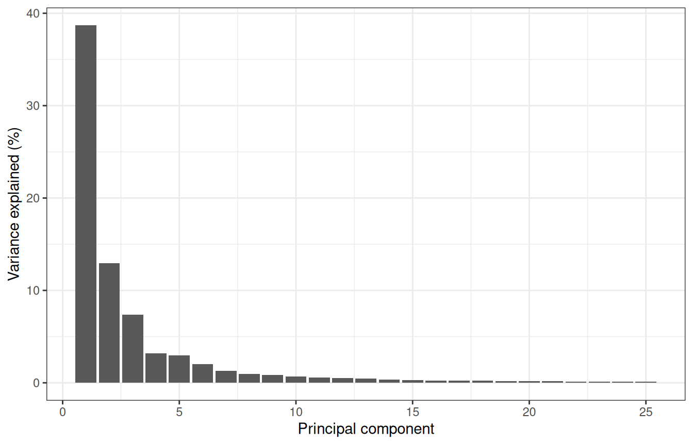

The first components carry most of the signal, and we keep 25, `scrapper`’s default: anything between 10 and 50 would give a similar picture here.

``` r
plotReducedDim(sce, "PCA", colour_by = "Donor")
```

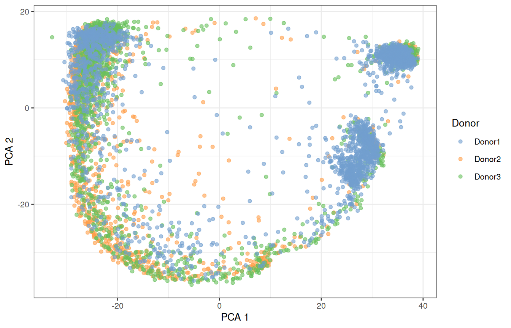

### 2.7.2 UMAP

The first two PCs only show part of the structure. UMAP ([McInnes et al. 2018](#ref-mcinnes2018)) squeezes all 25 PCs into two dimensions that we can look at:

``` r
sce <- runUmap.se(sce)
plotReducedDim(sce, "UMAP", colour_by = "Donor")
```

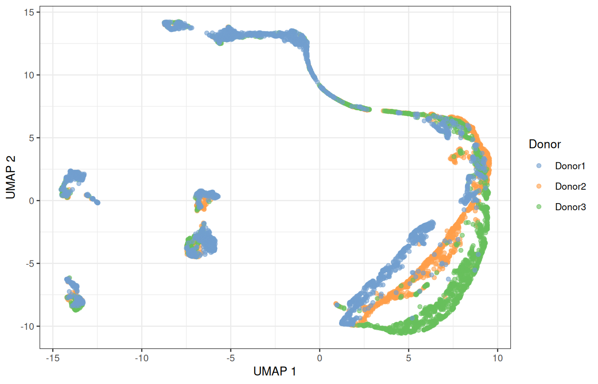

> **IMPORTANT:**
>
> UMAP keeps cells that are close in the PCA space close in the picture, but distances between distant groups, and the size of a group, mean little. Use it to look at the data, and run the analysis itself on the PCs.

## 2.8 Batch effects

**Do the donors overlap, or does each of them form its own island?** That is the first thing to look at, every time. Here, several populations split by donor. Part of that is biology (donors are different people) and part is technical: their samples were collected and processed separately. If we cluster now, some clusters will be donors rather than cell types.

The mutual nearest neighbours (MNN) method ([Haghverdi et al. 2018](#ref-haghverdi2018)) pairs cells across donors that are each other’s closest match: such pairs are assumed to be the same cell type, and the differences between them measure the batch effect, which is then removed from all cells. [`correctMnn.se()`](https://rdrr.io/pkg/scrapper/man/correctMnn.se.html) stores the corrected PCs as a new reduced dimension, `MNN`:

``` r
sce <- correctMnn.se(sce, block = sce$Donor)
reducedDimNames(sce)
##  [1] "PCA"  "UMAP" "MNN"
sce <- runUmap.se(sce, reddim.type = "MNN", output.name = "UMAP_MNN")
plotReducedDim(sce, "UMAP_MNN", colour_by = "Donor")
```

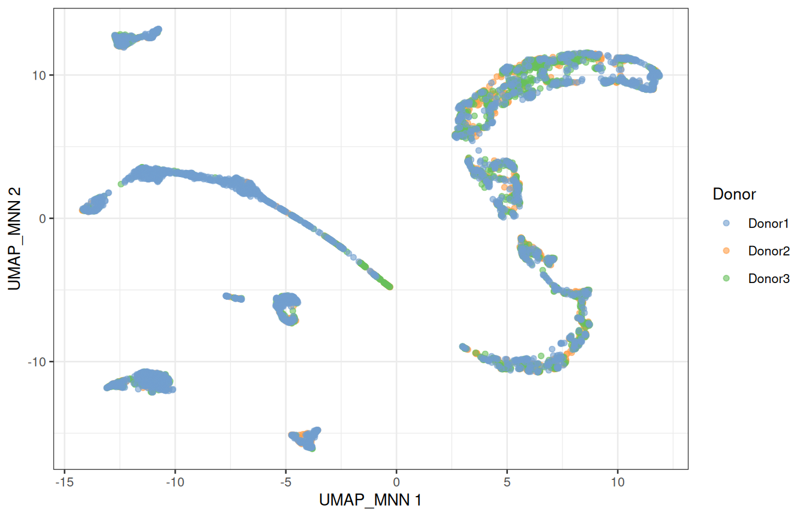

### 2.8.1 Is any of this real?

Before trusting a picture, check it against something you know ([Figure fig-testis](#fig-testis)): `UTF1` marks spermatogonial stem cells, `SYCP3` meiotic spermatocytes, `PRM2` spermatids, and `ACTA2` the peritubular myoid cells, a somatic population.

``` r
plotReducedDim(sce, "UMAP_MNN", colour_by = "UTF1") +
    plotReducedDim(sce, "UMAP_MNN", colour_by = "SYCP3") +
    plotReducedDim(sce, "UMAP_MNN", colour_by = "PRM2") +
    plotReducedDim(sce, "UMAP_MNN", colour_by = "ACTA2")
```

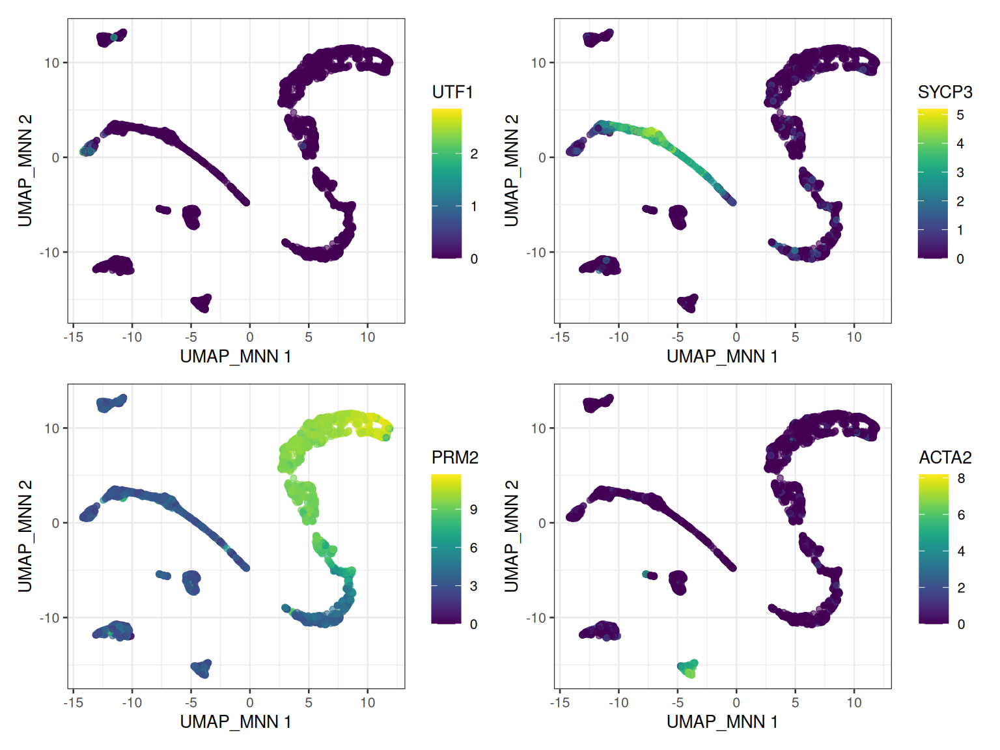

The germ cells line up along one continuous path, from stem cells to spermatids: the **trajectory** of spermatogenesis. The somatic cells form separate islands.

> **IMPORTANT:**
>
> Batch correction changes the data to make donors look alike. Use the corrected space to visualise and cluster the cells, never to test for differential expression: for that, we go back to the raw counts and model the donor explicitly ([sec-pseudobulk](#sec-pseudobulk)).

## 2.9 ☕ Break, and checkpoint

Look at everything the object now holds:

``` r
sce
##  class: SingleCellExperiment 
##  dim: 27477 5583 
##  metadata(2): qc PCA
##  assays(2): counts logcounts
##  rownames(27477): RP11-34P13.3 RP11-34P13.7 ... AC136612.1 AC145212.4
##  rowData names(5): means variances fitted residuals hvg
##  colnames(5583): Donor2.AAACCTGGTGCCTTGG.1 Donor2.AAACCTGTCAACGGGA.1
##    ... Donor1.TTTGTCAGTGTGCGTC.2 Donor1.TTTGTCATCCAAACTG.2
##  colData names(9): Donor Barcode ... keep sizeFactor
##  reducedDimNames(4): PCA UMAP MNN UMAP_MNN
##  mainExpName: NULL
##  altExpNames(0):
```

Two assays, quality metrics and size factors in [`colData()`](https://rdrr.io/pkg/SummarizedExperiment/man/SummarizedExperiment-class.html), gene statistics in [`rowData()`](https://rdrr.io/pkg/SummarizedExperiment/man/SummarizedExperiment-class.html), and four reduced dimensions: one hour of work in a single variable.

> **TIP:**
>
> The workshop package holds a copy of `sce` as it is at this point, without the `logcounts` to keep it small. Restart R (*Session* \> *Restart R*), then load it and compute the `logcounts` again, as in [sec-norm](#sec-norm):
>
> ``` r
> library(SingleCellExperiment)
> library(scrapper)
> library(scater)
> library(ggplot2)
> library(patchwork)
> sce <- GenE2scRNAseqIntro::sce_checkpoint
> sce <- normalizeRnaCounts.se(sce, size.factors = sce$sum, block = sce$Sample)
> ```

## 2.10 Clustering

In bulk RNA-seq, you **know** your groups: treated and untreated, tumour and normal. In single-cell RNA-seq, the groups are what you are looking for.

The standard approach is **graph-based clustering**:

1.  connect each cell to its nearest neighbours in the (corrected) PCA space;
2.  weight each connection by the number of neighbours the two cells share;
3.  cut the graph into communities of densely connected cells, with a community-detection algorithm (Louvain, Leiden…).

It scales to millions of cells and makes no assumption about the shape of the clusters.

``` r
sce <- clusterGraph.se(sce, reddim.type = "MNN")
table(sce$clusters)
##  
##    1   2   3   4   5   6   7   8   9  10  11  12  13  14  15  16  17  18  19 
##  376 268 340 482 174 358 223 244 289 298 369 287 330 317 346 339 135 235 173
plotReducedDim(sce, "UMAP_MNN", colour_by = "clusters", text_by = "clusters")
```

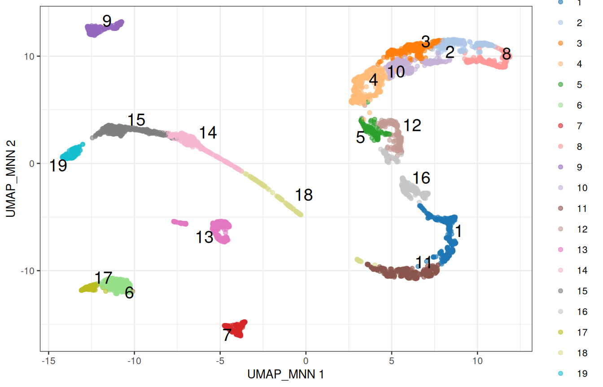

### 2.10.1 The number of neighbours is a resolution dial

With few neighbours, the graph is sparse and splits into many small communities; with many neighbours, it forms fewer, larger ones:

``` r
neighbours <- c(5, 10, 20, 50)
n_clusters <- sapply(neighbours, function(k) {
    sce_k <- clusterGraph.se(sce, reddim.type = "MNN", num.neighbors = k)
    length(unique(sce_k$clusters))
})
data.frame(neighbours, n_clusters)
##    neighbours n_clusters
##  1          5         28
##  2         10         19
##  3         20         15
##  4         50         13
```

There is no *correct* number of clusters, only the resolution at which the biology you care about becomes visible. Clustering is a tool to generate hypotheses, not a measurement: if two clusters have the same markers, merge them; if a cluster obviously contains two cell types, split it.

### 2.10.2 Are the clusters shared between donors?

``` r
composition <- table(cluster = sce$clusters, donor = sce$Donor)
composition
##         donor
##  cluster Donor1 Donor2 Donor3
##       1      81    163    132
##       2      71     71    126
##       3      55    116    169
##       4      90    180    212
##       5      49     48     77
##       6     222     66     70
##       7     115     89     19
##       8     138     35     71
##       9     135     71     83
##       10     64     68    166
##       11     89    156    124
##       12     60    122    105
##       13    223     37     70
##       14    269     12     36
##       15    288     10     48
##       16     74    131    134
##       17     48     41     46
##       18     48     86    101
##       19    129     13     31
ggplot(as.data.frame(composition), aes(x = cluster, y = Freq, fill = donor)) +
    geom_col(position = "fill") +
    labs(x = "Cluster", y = "Proportion of cells") +
    theme_bw()
```

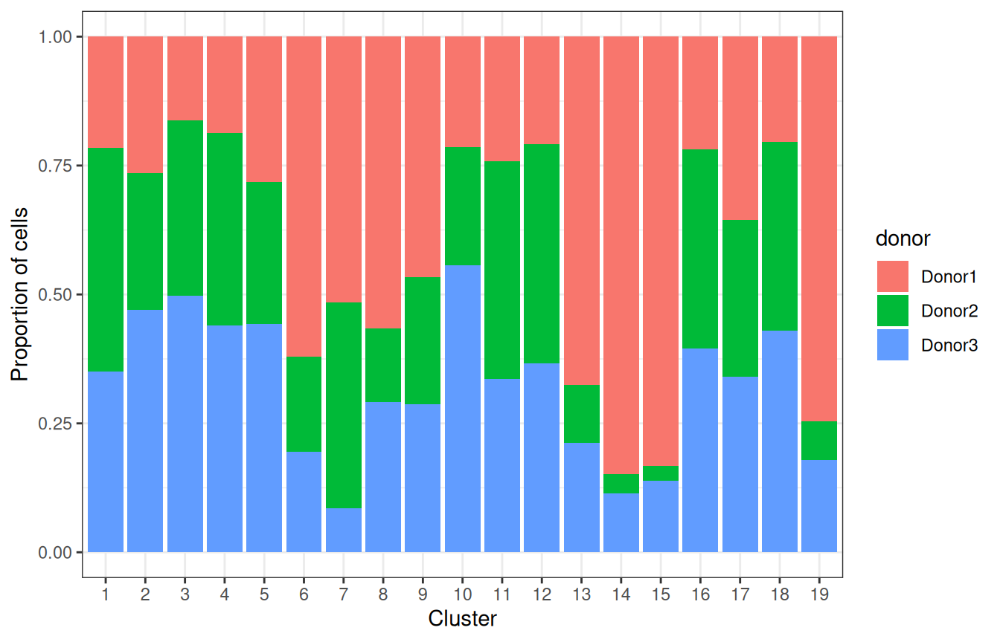

Most clusters gather cells from the three donors, but a few are dominated by `Donor1`. A batch effect left over, or populations that are more abundant in that donor? A cluster made of a single donor is suspect; one where the other donors are present, but rarer, is more likely a difference in composition. The markers will tell ([sec-markers](#sec-markers)).

## 2.11 Marker genes

Clusters are numbers; biology needs names. Two complementary approaches: check genes we already know, and ask the data which genes distinguish each cluster.

### 2.11.1 Known markers

[Figure fig-testis](#fig-testis) lists genes that mark each cell type of the testis:

``` r
panels <- list(
    SSC            = c("UTF1", "ID4", "PIWIL4"),
    Spermatogonia  = c("DMRT1", "KIT", "MKI67"),
    Spermatocyte   = c("SYCP3", "DMC1", "SPO11"),
    RoundSpermatid = c("SUN5", "ACR", "BRDT"),
    ElongSpermatid = c("TNP1", "PRM1", "PRM2"),
    Sertoli        = c("SOX9", "AMH"),
    Leydig         = c("DLK1", "INHBA", "CYP17A1"),
    Myoid          = c("MYH11", "ACTA2"),
    Endothelial    = c("VWF", "PECAM1"),
    Macrophage     = c("CD14", "TYROBP")
)
```

``` r
plotDots(sce, features = unlist(panels), group = "clusters") +
    theme(axis.text.x = element_text(angle = 45, hjust = 1))
```

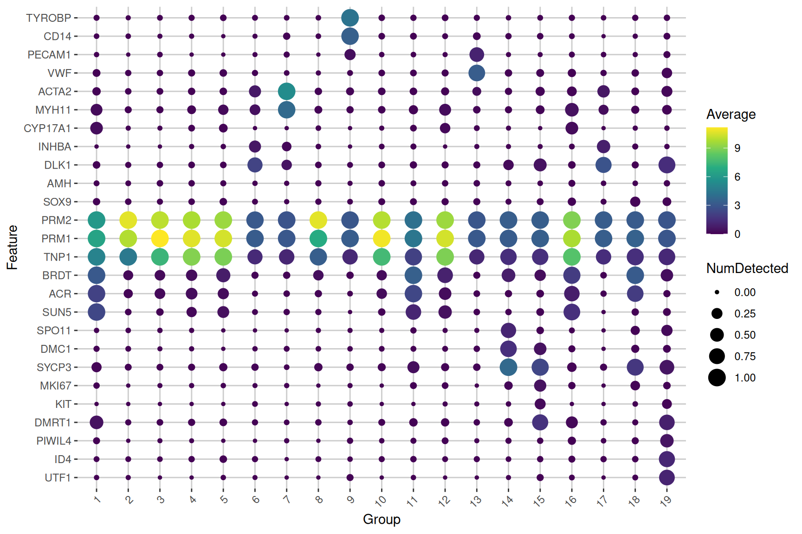

The size of a dot is the fraction of the cells of a cluster in which the gene is detected; its colour, the average expression in the cluster. Read along each cluster, and the names start writing themselves.

### 2.11.2 Markers found by the data

[`scoreMarkers.se()`](https://rdrr.io/pkg/scrapper/man/scoreMarkers.se.html) compares each cluster with every other one, gene by gene, and summarises the comparisons with **effect sizes**: Cohen’s *d* (the difference in mean expression, in units of standard deviation), the AUC (the probability that a cell of the cluster expresses the gene more than a cell of the other cluster), or the difference in the proportion of cells expressing it. Blocking on the donor makes the comparisons within each donor.

``` r
markers <- scoreMarkers.se(sce, groups = sce$clusters, block = sce$Donor)
names(markers)
##   [1] "1"  "2"  "3"  "4"  "5"  "6"  "7"  "8"  "9"  "10" "11" "12" "13" "14"
##  [15] "15" "16" "17" "18" "19"
```

One table per cluster, with genes sorted by their average Cohen’s *d* against the other clusters. [`previewMarkers()`](https://rdrr.io/pkg/scrapper/man/scoreMarkers.se.html) shows the essential columns: the mean expression in the cluster, the proportion of its cells expressing the gene, and the average log-fold change with the other clusters.

``` r
previewMarkers(markers[["1"]])
##  DataFrame with 10 rows and 3 columns
##               mean  detected       lfc
##          <numeric> <numeric> <numeric>
##  FAM209A   3.81715  1.000000   3.23254
##  ERICH2    4.07027  1.000000   3.43419
##  FAM209B   3.52768  0.997340   2.99865
##  SPACA1    3.19499  0.997340   2.94081
##  SPACA4    2.84263  0.997340   2.43344
##  ACTL7B    3.09472  0.997340   2.35299
##  WBSCR28   2.77236  1.000000   2.33354
##  ACTRT3    2.89559  0.992021   2.47236
##  FAM229A   4.36613  1.000000   2.72686
##  CDKN3     3.79537  0.997340   2.63692
```

Plot the best marker of cluster 1 on the map:

``` r
top_gene <- rownames(markers[["1"]])[1]
plotReducedDim(sce, "UMAP_MNN", colour_by = top_gene, text_by = "clusters")
```

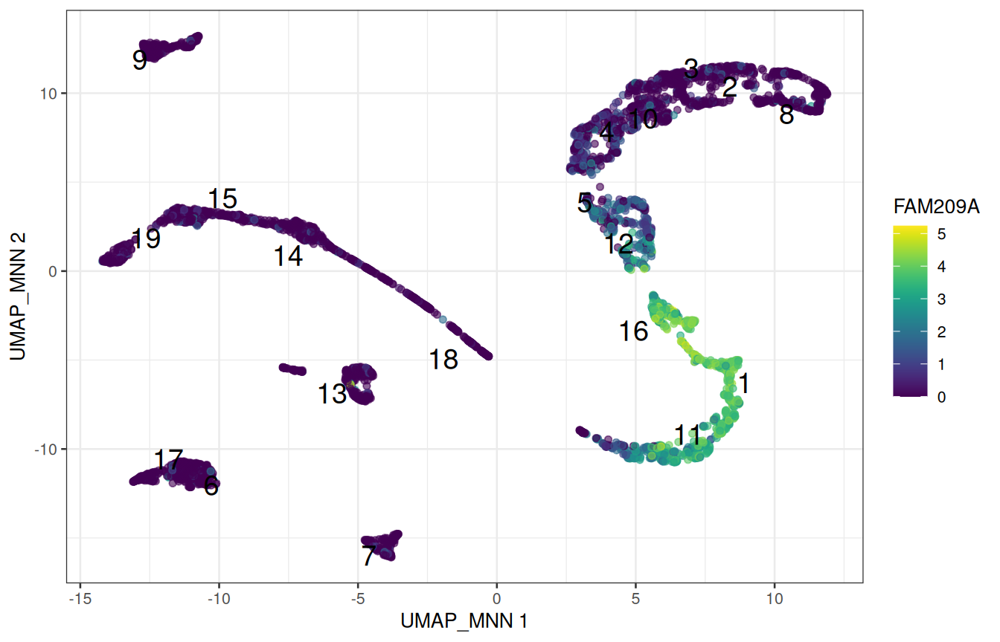

> **NOTE:**
>
> Pick a cluster that looks somatic on the dot plot, and look at its top markers. Do they agree with [Figure fig-testis](#fig-testis)?
>
> Why do we look at effect sizes, and not at p-values, to rank marker genes?

> **NOTE:**
>
> Replace `"1"` with the cluster of your choice, e.g. `previewMarkers(markers[["7"]])`.
>
> The clusters were defined from these very expression values, precisely to separate cells that differ. Testing whether they differ would be circular: the p-values would all be tiny, and mean nothing. Effect sizes still rank genes by how well they separate the clusters, which is all we need here.

## 2.12 Annotation with a reference

Annotating by hand does not scale, and only finds what you thought of looking for. The alternative is to compare the cells with a **reference**: a dataset whose cell types are already known.

`SingleR` ([Aran et al. 2019](#ref-aran2019)) correlates each cell, or here each cluster, with the profile of each cell type of the reference, using only genes that distinguish the reference cell types, and keeps the best match. The workshop package provides a reference built from the single-cell type atlas of the Human Protein Atlas ([Karlsson et al. 2021](#ref-karlsson2021)): the average expression of each gene in 154 cell types from many tissues, the testis included.

``` r
HPA_ref <- GenE2scRNAseqIntro::HPA_ref
HPA_ref
##  class: SummarizedExperiment 
##  dim: 20151 154 
##  metadata(0):
##  assays(1): logcounts
##  rownames(20151): TSPAN6 TNMD ... ENSG00000291316 TMEM276
##  rowData names(0):
##  colnames(154): adipocytes adrenal cortex cells ... vascular
##    endothelial cells vascular smooth muscle cells
##  colData names(1): label
head(sort(unique(HPA_ref$label)), 20)
##   [1] "adipocytes"                      "adrenal cortex cells"           
##   [3] "adrenal medulla cells"           "alveolar cells type 1"          
##   [5] "alveolar cells type 2"           "astrocytes"                     
##   [7] "b-cells"                         "basal keratinocytes"            
##   [9] "basal prostatic cells"           "bergmann glia"                  
##  [11] "brain excitatory neurons"        "brain inhibitory neurons"       
##  [13] "breast hormone-responsive cells" "breast lactating cells"         
##  [15] "breast myoepithelial cells"      "breast secretory cells"         
##  [17] "cardiomyocytes"                  "cdc"                            
##  [19] "cholangiocytes"                  "choroid plexus epithelial cells"
```

With `clusters =`, `SingleR` first pools the cells of each cluster, and labels the cluster as a whole: a pooled profile is much less noisy than a single cell.

``` r
library(SingleR)
pred <- SingleR(
    test = sce,
    ref = HPA_ref,
    labels = HPA_ref$label,
    clusters = sce$clusters
)
pred[, c("labels", "pruned.labels")]
##  DataFrame with 19 rows and 2 columns
##                      labels          pruned.labels
##                 <character>            <character>
##  1         early spermatids       early spermatids
##  2          late spermatids        late spermatids
##  3          late spermatids        late spermatids
##  4          late spermatids        late spermatids
##  5          late spermatids        late spermatids
##  ...                    ...                    ...
##  15  differentiating sper.. differentiating sper..
##  16        early spermatids       early spermatids
##  17            leydig cells           leydig cells
##  18  late primary spermat.. late primary spermat..
##  19  undifferentiated spe.. undifferentiated spe..
```

`pred` has one row per cluster. To give each **cell** the label of its cluster, use a named vector as a lookup table:

``` r
label_of_cluster <- setNames(pred$labels, rownames(pred))
sce$celltype <- label_of_cluster[as.character(sce$clusters)]
table(sce$celltype)
##  
##   differentiating spermatogonia    early primary spermatocytes 
##                             346                            317 
##                early spermatids     late primary spermatocytes 
##                             715                            604 
##                 late spermatids                   leydig cells 
##                            2093                            493 
##                     macrophages        peritubular myoid cells 
##                             289                            223 
##  undifferentiated spermatogonia     vascular endothelial cells 
##                             173                            330
```

``` r
plotReducedDim(
    sce, "UMAP_MNN",
    colour_by = "celltype", text_by = "celltype", text_size = 3.5
)
```

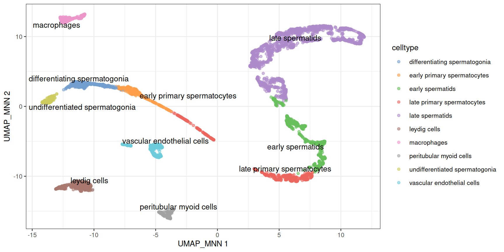

Two things to observe on this map:

- The germ-cell labels line up along the differentiation path, in developmental order. Spermatogenesis is a **trajectory**, and clustering has cut it into segments whose boundaries depend on the resolution: do not over-interpret them.
- The somatic labels mark discrete populations: their boundaries are real.

> **NOTE:**
>
> In [sec-clustering](#sec-clustering), a few clusters were dominated by `Donor1`. Which cell types are they?

> **NOTE:**
>
> ``` r
> table(sce$celltype, sce$Donor)
> ##                                  
> ##                                   Donor1 Donor2 Donor3
> ##    differentiating spermatogonia     288     10     48
> ##    early primary spermatocytes       269     12     36
> ##    early spermatids                  155    294    266
> ##    late primary spermatocytes        137    242    225
> ##    late spermatids                   527    640    926
> ##    leydig cells                      270    107    116
> ##    macrophages                       135     71     83
> ##    peritubular myoid cells           115     89     19
> ##    undifferentiated spermatogonia    129     13     31
> ##    vascular endothelial cells        223     37     70
> ```
>
> `Donor1` contributes most of the spermatogonia and of the early spermatocytes. The cells of the other donors are present in the same clusters, just rarer: these samples differ in composition, which is biology (or sampling), not a batch effect.

> **WARNING:**
>
> `SingleR` always returns the closest label, even when the right one is not in the reference: check the labels against the markers. `pruned.labels` is `NA` for the clusters whose best label barely beats the second best, which deserve a second look.

## 2.13 Pseudobulk differential expression

### 2.13.1 The unit of replication is the donor

We could compare two groups of **cells** directly, with thousands of cells per group. But cells from the same donor are not independent observations: they share a genome, a history and a sample preparation. Three donors are three biological replicates, whether they gave 600 cells or 600,000. Tests that treat each cell as a replicate give wildly over-confident p-values ([Squair et al. 2021](#ref-squair2021)).

The standard solution is the **pseudobulk**: sum the counts of all the cells of one cell type within one donor. This gives back a small, bulk-like matrix, with one column per cell type and donor, which bulk RNA-seq tools such as `DESeq2` ([Love et al. 2014](#ref-love2014)) analyse well. The two 10x runs of each donor are technical replicates: they are summed too.

``` r
pb <- aggregateAcrossCells.se(
    sce,
    factors = colData(sce)[, c("celltype", "Donor")]
)
pb
##  class: RangedSummarizedExperiment 
##  dim: 27477 30 
##  metadata(1): aggregated
##  assays(2): sums detected
##  rownames(27477): RP11-34P13.3 RP11-34P13.7 ... AC136612.1 AC145212.4
##  rowData names(5): means variances fitted residuals hvg
##  colnames: NULL
##  colData names(14): factor.celltype factor.Donor ... clusters
##    celltype
head(colData(pb)[, c("factor.celltype", "factor.Donor", "counts")])
##  DataFrame with 6 rows and 3 columns
##           factor.celltype factor.Donor    counts
##               <character>  <character> <integer>
##  1 differentiating sper..       Donor1       288
##  2 differentiating sper..       Donor2        10
##  3 differentiating sper..       Donor3        48
##  4 early primary sperma..       Donor1       269
##  5 early primary sperma..       Donor2        12
##  6 early primary sperma..       Donor3        36
```

Each column of `pb` is one cell type in one donor; the `counts` column of `colData(pb)` says how many cells were summed. Let’s compare the two earliest germ-cell populations: the spermatogonial stem cells (*undifferentiated spermatogonia*) and the spermatogonia that have started to differentiate.

``` r
spermatogonia <- c(
    "undifferentiated spermatogonia",
    "differentiating spermatogonia"
)
pb_sg <- pb[, pb$factor.celltype %in% spermatogonia]
samples <- data.frame(
    celltype = factor(pb_sg$factor.celltype, levels = spermatogonia),
    donor = factor(pb_sg$factor.Donor),
    ncells = pb_sg$counts
)
samples
##                          celltype  donor ncells
##  1  differentiating spermatogonia Donor1    288
##  2  differentiating spermatogonia Donor2     10
##  3  differentiating spermatogonia Donor3     48
##  4 undifferentiated spermatogonia Donor1    129
##  5 undifferentiated spermatogonia Donor2     13
##  6 undifferentiated spermatogonia Donor3     31
```

### 2.13.2 Testing with `DESeq2`

> **NOTE:**
>
> `DESeq2` models the **raw counts** of each gene with a negative binomial distribution, corrects for differences in library size with its own size factors, and shares information across genes to estimate how variable each gene is between replicates. The **design formula** describes the experiment: `~ donor + celltype` compares the two cell types *within* each donor, which is a paired design, and removes the differences between donors.

``` r
library(DESeq2)
dds <- DESeqDataSetFromMatrix(
    countData = assay(pb_sg, "sums"),
    colData = samples,
    design = ~ donor + celltype
)
dds <- dds[rowSums(counts(dds) >= 10) >= 3, ]
dds <- DESeq(dds)
res <- results(
    dds,
    contrast = c(
        "celltype",
        "differentiating spermatogonia",   # numerator
        "undifferentiated spermatogonia"   # denominator
    )
)
summary(res)
##  
##  out of 9296 with nonzero total read count
##  adjusted p-value < 0.1
##  LFC > 0 (up)       : 1276, 14%
##  LFC < 0 (down)     : 1551, 17%
##  outliers [1]       : 0, 0%
##  low counts [2]     : 0, 0%
##  (mean count < 4)
##  [1] see 'cooksCutoff' argument of ?results
##  [2] see 'independentFiltering' argument of ?results
```

The first line keeps the genes with at least 10 counts in at least 3 of the 6 pseudo-samples. A positive log-fold change means a higher expression in the differentiating spermatogonia. The most significant genes:

``` r
res_df <- as.data.frame(res)
res_df <- res_df[order(res_df$padj), ]
head(res_df[, c("baseMean", "log2FoldChange", "padj")], 10)
##           baseMean log2FoldChange         padj
##  GLTSCR2  330.7308      -3.092754 4.469290e-37
##  GNB2L1   908.1871      -2.704693 1.088643e-35
##  RPS4X    500.3155      -3.806374 2.286257e-34
##  RPS12   5573.5759      -2.169381 8.037935e-33
##  ID1      106.1675      -6.733731 3.563133e-30
##  FKBP8    377.5046      -2.765938 3.563133e-30
##  ZNF428   366.4472      -3.265353 1.155811e-29
##  SMC1B    309.8769       2.639109 1.515493e-28
##  TPT1    1201.1534      -2.122662 2.288828e-28
##  TUBB     206.6682      -3.281781 1.285149e-27
```

Without being told anything, the test recovers the biology of the testis: the stem-cell markers of [Figure fig-testis](#fig-testis) are higher in the undifferentiated cells, and genes of meiosis such as `SYCP3` are switched on in the differentiating ones.

``` r
res_df[c("UTF1", "ID4", "PIWIL4", "SYCP3", "MKI67"), c("log2FoldChange", "padj")]
##         log2FoldChange         padj
##  UTF1        -5.040454 1.712591e-22
##  ID4         -6.022109 1.519560e-24
##  PIWIL4      -4.951947 4.427993e-12
##  SYCP3        3.073369 4.548859e-27
##  MKI67        2.570769 1.237965e-04
```

``` r
res_df <- res_df[!is.na(res_df$padj), ]
ggplot(res_df, aes(x = log2FoldChange, y = -log10(padj), colour = padj < 0.05)) +
    geom_point(size = 0.8) +
    scale_colour_manual(values = c(`FALSE` = "grey70", `TRUE` = "firebrick")) +
    labs(
        x = "log2 fold change, differentiating / undifferentiated",
        y = "-log10(adjusted p-value)"
    ) +
    theme_bw()
```

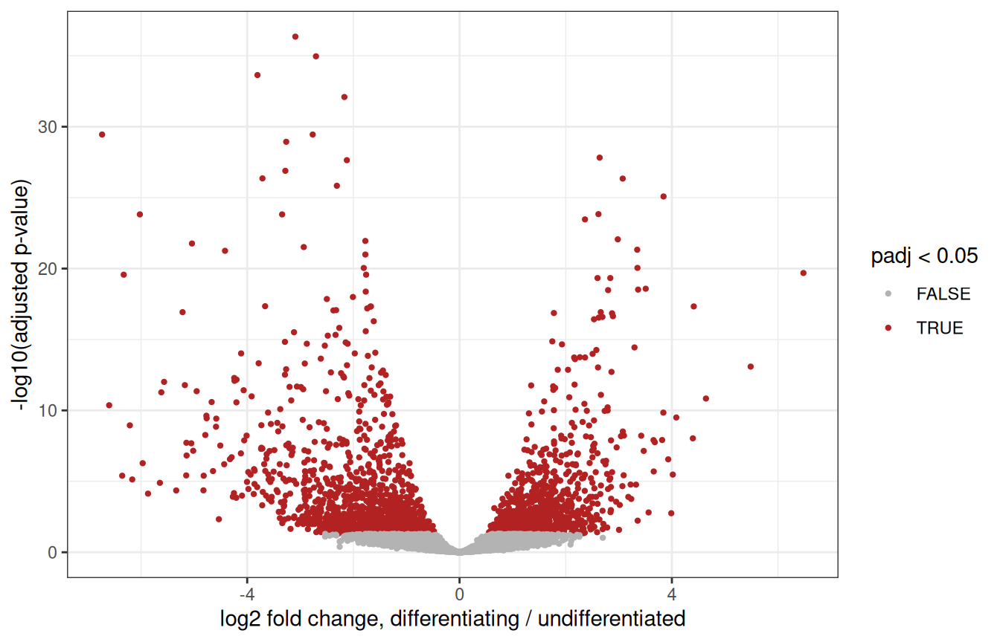

> **WARNING:**
>
> Our two groups were defined from the expression data, by clustering: they were chosen to be different, so the p-values above are optimistic. Here, `DESeq2` mostly helps rank genes.
>
> Pseudobulk analyses shine when the groups are defined independently of the expression data: comparing **conditions** (healthy *vs* infertile donors, treated *vs* untreated…) **within one cell type**, with several donors per condition. The code is exactly the same, with `~ condition` in the design.

## 2.14 Wrap-up

### 2.14.1 What we did

``` r
# read the counts, and build the object
umi <- read.delim(umi_path, header = TRUE, row.names = 1)
counts_sparse <- Matrix(as.matrix(umi), sparse = TRUE)
sce <- SingleCellExperiment(assays = list(counts = counts_sparse))
split_names <- strsplit(colnames(sce), "\\.")
sce$Donor <- sapply(split_names, function(x) x[1])
sce$Replicate <- sapply(split_names, function(x) x[3])
sce$Sample <- paste(sce$Donor, sce$Replicate, sep = "_rep")
# quality control
is_mito <- grepl("^MT-", rownames(sce))
sce <- quickRnaQc.se(sce, subsets = list(Mito = is_mito), block = sce$Sample)
sce <- sce[, sce$keep]
# normalisation, feature selection, PCA
sce <- normalizeRnaCounts.se(sce, size.factors = sce$sum, block = sce$Sample)
sce <- chooseRnaHvgs.se(sce, block = sce$Sample, top = 2000)
sce <- runPca.se(sce, features = rowData(sce)$hvg, number = 25)
# batch correction, UMAP
sce <- correctMnn.se(sce, block = sce$Donor)
sce <- runUmap.se(sce, reddim.type = "MNN", output.name = "UMAP_MNN")
# clusters, markers, cell types
sce <- clusterGraph.se(sce, reddim.type = "MNN")
markers <- scoreMarkers.se(sce, groups = sce$clusters, block = sce$Donor)
pred <- SingleR(sce, ref = HPA_ref, labels = HPA_ref$label, clusters = sce$clusters)
sce$celltype <- setNames(pred$labels, rownames(pred))[as.character(sce$clusters)]
# pseudobulk
pb <- aggregateAcrossCells.se(sce, factors = colData(sce)[, c("celltype", "Donor")])
```

About twenty lines of code. Everything else was looking at the results and deciding whether to believe them, which is the actual job.

### 2.14.2 Where to go next

- The [`scrapbook`](https://bioconductor.org/books/release/scrapbook/) and [OSCA](https://bioconductor.org/books/release/OSCA/) books ([Amezquita et al. 2020](#ref-amezquita2020)) explain each of these steps, and their alternatives, in depth.
- Spermatogenesis is a trajectory: *pseudotime* methods such as `TSCAN` or `slingshot` order the cells along it.
- For spatial transcriptomics, the [OSTA](https://bioconductor.org/books/release/OSTA/) book applies the same containers and many of the same steps to Visium and other technologies.

### 2.14.3 Exercises

**1. Batch effects.** Cluster the cells on the **uncorrected** PCs, and redo the composition plot of [sec-clustering](#sec-clustering). What changed?

> **NOTE:**
>
> ``` r
> sce$clusters_uncorrected <- clusterGraph.se(sce, reddim.type = "PCA")$clusters
> composition <- table(cluster = sce$clusters_uncorrected, donor = sce$Donor)
> ggplot(as.data.frame(composition), aes(x = cluster, y = Freq, fill = donor)) +
>     geom_col(position = "fill")
> ```
>
> Several clusters now contain cells of a single donor: without correction, part of the clustering separates donors rather than cell types.

**2. Feature selection.** Redo the analysis with the top 500, then the top 5,000 HVGs, and compare the UMAPs. How sensitive is the picture to that choice?

> **NOTE:**
>
> ``` r
> sce_500 <- chooseRnaHvgs.se(sce, block = sce$Sample, top = 500)
> sce_500 <- runPca.se(sce_500, features = rowData(sce_500)$hvg, number = 25)
> sce_500 <- correctMnn.se(sce_500, block = sce_500$Donor)
> sce_500 <- runUmap.se(sce_500, reddim.type = "MNN", output.name = "UMAP_MNN")
> plotReducedDim(sce_500, "UMAP_MNN", colour_by = "celltype")
> ```
>
> Then the same with `top = 5000`. The overall structure is robust; the fine details of the map are not.

**3. Another reference.** Annotate the clusters with the *Human Primary Cell Atlas*, a reference of purified cell types from the `celldex` package (it is already downloaded in the workshop environment). Which populations does it recognise, and what does it call the germ cells?

> **NOTE:**
>
> ``` r
> hpca <- celldex::HumanPrimaryCellAtlasData()
> pred_hpca <- SingleR(
>     test = sce, ref = hpca, labels = hpca$label.main, clusters = sce$clusters
> )
> data.frame(cluster = rownames(pred), HPA = pred$labels, HPCA = pred_hpca$labels)
> ```
>
> The Human Primary Cell Atlas contains no germ cells: `SingleR` still gives them the closest label it has. A reference can only recognise what it contains.

**4. Somatic cells.** Compare the Leydig cells with the peritubular myoid cells, with a pseudobulk analysis. Which genes come up?

> **NOTE:**
>
> ``` r
> somatic <- c("leydig cells", "peritubular myoid cells")
> pb_soma <- pb[, pb$factor.celltype %in% somatic]
> samples_soma <- data.frame(
>     celltype = factor(pb_soma$factor.celltype, levels = somatic),
>     donor = factor(pb_soma$factor.Donor)
> )
> dds_soma <- DESeqDataSetFromMatrix(
>     countData = assay(pb_soma, "sums"),
>     colData = samples_soma,
>     design = ~ donor + celltype
> )
> dds_soma <- dds_soma[rowSums(counts(dds_soma) >= 10) >= 3, ]
> dds_soma <- DESeq(dds_soma)
> res_soma <- as.data.frame(results(dds_soma))
> head(res_soma[order(res_soma$padj), ], 10)
> ```

## Session info

> **NOTE:**
>
> ``` r
> sessionInfo()
> ##  R version 4.6.1 (2026-06-24)
> ##  Platform: x86_64-pc-linux-gnu
> ##  Running under: Ubuntu 24.04.5 LTS
> ##  
> ##  Matrix products: default
> ##  BLAS:   /usr/lib/x86_64-linux-gnu/openblas-pthread/libblas.so.3 
> ##  LAPACK: /usr/lib/x86_64-linux-gnu/openblas-pthread/libopenblasp-r0.3.26.so;  LAPACK version 3.12.0
> ##  
> ##  locale:
> ##   [1] LC_CTYPE=en_US.UTF-8       LC_NUMERIC=C              
> ##   [3] LC_TIME=en_US.UTF-8        LC_COLLATE=C              
> ##   [5] LC_MONETARY=en_US.UTF-8    LC_MESSAGES=en_US.UTF-8   
> ##   [7] LC_PAPER=en_US.UTF-8       LC_NAME=C                 
> ##   [9] LC_ADDRESS=C               LC_TELEPHONE=C            
> ##  [11] LC_MEASUREMENT=en_US.UTF-8 LC_IDENTIFICATION=C       
> ##  
> ##  time zone: Etc/UTC
> ##  tzcode source: system (glibc)
> ##  
> ##  attached base packages:
> ##  [1] stats4    stats     graphics  grDevices utils     datasets  methods  
> ##  [8] base     
> ##  
> ##  other attached packages:
> ##   [1] DESeq2_1.53.6               SingleR_2.15.4             
> ##   [3] patchwork_1.3.2             scater_1.41.3              
> ##   [5] ggplot2_4.0.3               scuttle_1.23.2             
> ##   [7] scrapper_1.7.9              SingleCellExperiment_1.35.2
> ##   [9] SummarizedExperiment_1.43.0 Biobase_2.73.2             
> ##  [11] GenomicRanges_1.65.4        Seqinfo_1.3.2              
> ##  [13] IRanges_2.47.5              S4Vectors_0.51.10          
> ##  [15] BiocGenerics_0.59.12        generics_0.1.4             
> ##  [17] MatrixGenerics_1.25.0       matrixStats_1.5.0          
> ##  [19] Matrix_1.7-6                BiocFileCache_3.3.0        
> ##  [21] dbplyr_2.6.0               
> ##  
> ##  loaded via a namespace (and not attached):
> ##   [1] tidyselect_1.2.1          viridisLite_0.4.3        
> ##   [3] dplyr_1.2.1               vipor_0.4.7              
> ##   [5] farver_2.1.2              blob_1.3.0               
> ##   [7] filelock_1.0.3            viridis_0.6.5            
> ##   [9] S7_0.2.2                  fastmap_1.2.0            
> ##  [11] digest_0.6.39             rsvd_1.0.6               
> ##  [13] lifecycle_1.0.5           RSQLite_3.53.3           
> ##  [15] magrittr_2.0.5            compiler_4.6.1           
> ##  [17] rlang_1.3.0               tools_4.6.1              
> ##  [19] yaml_2.3.12               knitr_1.52               
> ##  [21] labeling_0.4.3            S4Arrays_1.13.2          
> ##  [23] htmlwidgets_1.6.4         bit_4.6.0                
> ##  [25] curl_8.1.0                DelayedArray_0.39.8      
> ##  [27] RColorBrewer_1.1-3        abind_1.4-8              
> ##  [29] BiocParallel_1.47.0       withr_3.0.3              
> ##  [31] purrr_1.2.2               grid_4.6.1               
> ##  [33] beachmat_2.29.3           scales_1.4.0             
> ##  [35] cli_3.6.6                 rmarkdown_2.32           
> ##  [37] otel_0.2.0                DBI_1.3.0                
> ##  [39] ggbeeswarm_0.7.3          cachem_1.1.0             
> ##  [41] parallel_4.6.1            XVector_0.53.0           
> ##  [43] GenE2scRNAseqIntro_0.99.0 vctrs_0.7.3              
> ##  [45] jsonlite_2.0.0            BiocSingular_1.29.2      
> ##  [47] BiocNeighbors_2.7.3       bit64_4.8.6              
> ##  [49] ggrepel_0.9.8             irlba_2.4.1              
> ##  [51] beeswarm_0.4.0            locfit_1.5-9.12          
> ##  [53] glue_1.8.1                codetools_0.2-20         
> ##  [55] gtable_0.3.6              ScaledMatrix_1.21.0      
> ##  [57] tibble_3.3.1              pillar_1.11.1            
> ##  [59] htmltools_0.5.9           R6_2.6.1                 
> ##  [61] httr2_1.3.0               evaluate_1.0.5           
> ##  [63] lattice_0.23-1            memoise_2.0.1            
> ##  [65] Rcpp_1.1.2                gridExtra_2.3.1          
> ##  [67] SparseArray_1.13.4        xfun_0.62                
> ##  [69] pkgconfig_2.0.3
> ```

Amezquita, Robert A., Aaron T. L. Lun, Etienne Becht, et al. 2020. “Orchestrating Single-Cell Analysis with Bioconductor.” *Nature Methods* 17: 137–45. <https://doi.org/10.1038/s41592-019-0654-x>.

Aran, Dvir, Agnieszka P. Looney, Leqian Liu, et al. 2019. “Reference-Based Analysis of Lung Single-Cell Sequencing Reveals a Transitional Profibrotic Macrophage.” *Nature Immunology* 20: 163–72. <https://doi.org/10.1038/s41590-018-0276-y>.

Germain, Pierre-Luc, Aaron Lun, Carlos Garcia Meixide, Will Macnair, and Mark D. Robinson. 2021. “Doublet Identification in Single-Cell Sequencing Data Using scDblFinder.” *F1000Research* 10: 979. <https://doi.org/10.12688/f1000research.73600.2>.

Guo, Jingtao, Edward J. Grow, Hana Mlcochova, Geoffrey J. Maher, Cecilia Lindskog, et al. 2018. “The Adult Human Testis Transcriptional Cell Atlas.” *Cell Research* 28: 1141–57. <https://doi.org/10.1038/s41422-018-0099-2>.

Haghverdi, Laleh, Aaron T. L. Lun, Michael D. Morgan, and John C. Marioni. 2018. “Batch Effects in Single-Cell RNA-Sequencing Data Are Corrected by Matching Mutual Nearest Neighbors.” *Nature Biotechnology* 36: 421–27. <https://doi.org/10.1038/nbt.4091>.

Karlsson, Max, Cheng Zhang, Loren Méar, et al. 2021. “A Single-Cell Type Transcriptomics Map of Human Tissues.” *Science Advances* 7: eabh2169. <https://doi.org/10.1126/sciadv.abh2169>.

Love, Michael I., Wolfgang Huber, and Simon Anders. 2014. “Moderated Estimation of Fold Change and Dispersion for RNA-seq Data with DESeq2.” *Genome Biology* 15: 550. <https://doi.org/10.1186/s13059-014-0550-8>.

Lun, Aaron T. L., Karsten Bach, and John C. Marioni. 2016. “Pooling Across Cells to Normalize Single-Cell RNA Sequencing Data with Many Zero Counts.” *Genome Biology* 17: 75. <https://doi.org/10.1186/s13059-016-0947-7>.

McInnes, Leland, John Healy, and James Melville. 2018. *UMAP: Uniform Manifold Approximation and Projection for Dimension Reduction*. <https://doi.org/10.48550/arXiv.1802.03426>.

Squair, Jordan W., Matthieu Gautier, Claudia Kathe, et al. 2021. “Confronting False Discoveries in Single-Cell Differential Expression.” *Nature Communications* 12: 5692. <https://doi.org/10.1038/s41467-021-25960-2>.
